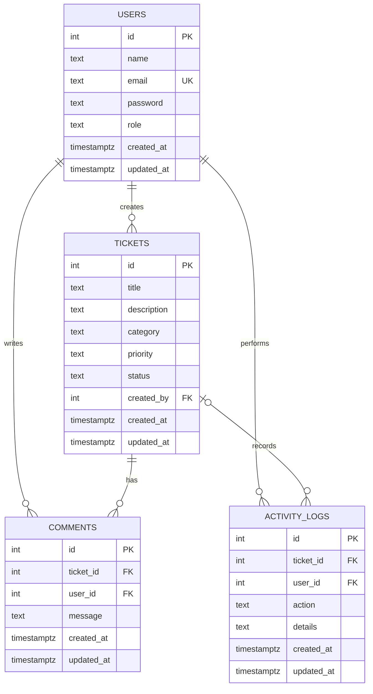

# Database Design

The application uses PostgreSQL. The schema is initialized by the backend at startup in `backend/src/db.js` with `CREATE TABLE IF NOT EXISTS`; the API uses the `pg` package and parameterized SQL queries. IDs are generated integer primary keys. Timestamps use `TIMESTAMPTZ` and default to the database's current time.

## Entity relationship

## Tables

### `users`

Stores account identity and authentication data. `email` is unique; `password` contains a bcrypt hash, never the submitted password. `role` is constrained to `user` or `admin` and defaults to `user`. Public registration cannot choose a role; the admin seed script provisions administrator accounts.

### `tickets`

Stores a support request and its current status. `created_by` references `users.id` and is required. `priority` is constrained to `low`, `medium`, or `high` and defaults to `medium`; `status` is constrained to `open`, `in-progress`, `resolved`, or `closed` and defaults to `open`. `created_by` and `status` have indexes for ownership and status lookups. Ownership is enforced in API controllers in addition to the foreign key.

### `comments`

Stores messages associated with one ticket and one user. `ticket_id` references `tickets.id` with `ON DELETE CASCADE`, so deleting a ticket removes its comments. `user_id` references `users.id` with `ON DELETE RESTRICT`; accounts with authored comments cannot be removed while those references remain. `ticket_id` is indexed for per-ticket comment lists.

### `activity_logs`

Stores the event type, details, actor, and timestamp for ticket activity. `user_id` references `users.id` with `ON DELETE RESTRICT`. `ticket_id` references `tickets.id` with `ON DELETE SET NULL`, allowing a deletion event to remain after the ticket itself is removed. `ticket_id` is indexed for activity history queries. Events include creation, updates, status and priority changes, comments, resolution, and deletion.

## Relationship and integrity decisions

- Foreign keys prevent tickets, comments, and activity from referencing nonexistent users or tickets.
- Ticket deletion cascades to comments. Activity records are retained with a null ticket reference, preserving the deletion audit entry.
- User deletion is restricted while tickets, comments, or activity rows reference that user. Account deletion is not exposed by the current API.
- Status, priority, and role constraints keep stored values within the application's supported states.
- SQL parameters are passed separately from query text to avoid building SQL from user-provided values.

## Initialization and deployment

The current initialization creates missing tables and indexes but does not alter existing tables. For iterative production schema changes, introduce versioned migrations. Configure the backend with `DATABASE_URL`; Render-provided PostgreSQL URLs are supported, with TLS enabled for Render external hosts. The health endpoint checks both API availability and database connectivity.
